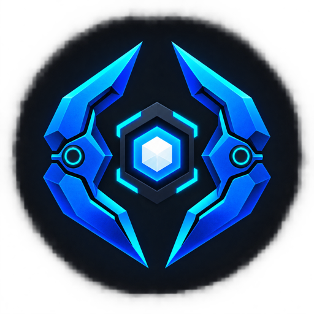
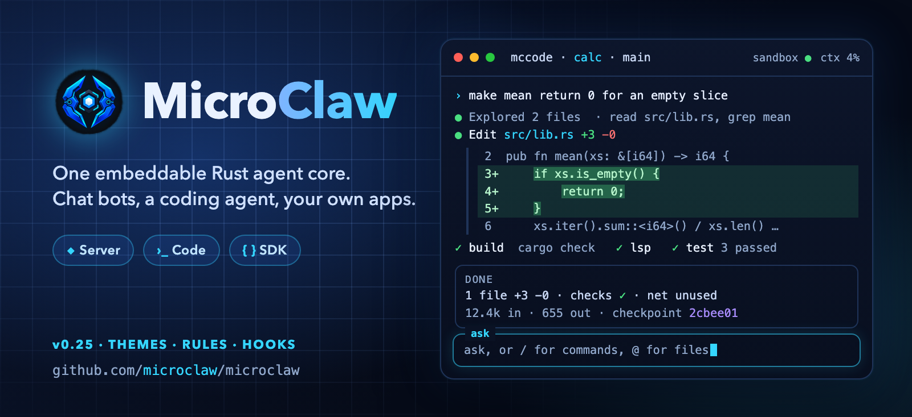
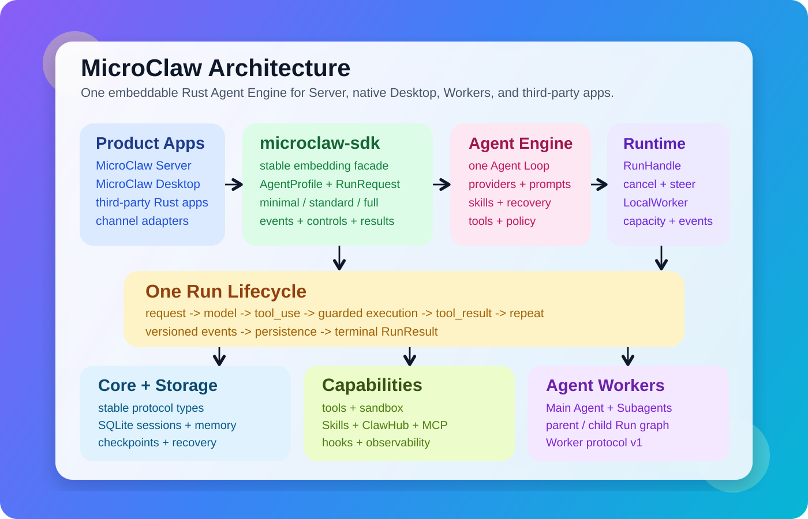

# MicroClaw



[English](README.md) · [简体中文](README_CN.md) · [हिन्दी](docs/i18n/README.hi.md) · [Español](docs/i18n/README.es.md) · [العربية](docs/i18n/README.ar.md) · [Français](docs/i18n/README.fr.md) · [বাংলা](docs/i18n/README.bn.md) · [Português](docs/i18n/README.pt.md) · [Bahasa Indonesia](docs/i18n/README.id.md) · [اردو](docs/i18n/README.ur.md)

> [!IMPORTANT]
> For production use, choose the [`stable`](https://github.com/microclaw/microclaw/tree/stable) branch. `main` moves quickly and may include breaking changes.

[](https://microclaw.org)
[](https://github.com/microclaw/microclaw/releases/latest)
[](https://discord.gg/eGzEaP6TzR)
[](https://www.reddit.com/r/microclaw/)
[](LICENSE)

<p align="center">
  
</p>

<p align="center">
  <strong>One embeddable Rust agent core. Two products, one SDK.</strong><br />
  Run MicroClaw Server, use the native Desktop app, or embed the same Agent Engine in your own Rust application.
</p>

<p align="center">
  <a href="#quick-start">Quick start</a> ·
  <a href="#embed-microclaw-in-rust">Rust SDK</a> ·
  <a href="#why-microclaw">Why MicroClaw</a> ·
  <a href="#capabilities">Capabilities</a> ·
  <a href="#documentation">Documentation</a>
</p>

MicroClaw is a self-hosted Rust agent platform with two products and an embeddable SDK. **MicroClaw Server** runs continuously for chat channels, Web, APIs, scheduling, and automation. **MicroClaw Desktop** is the local product: the native GPUI desktop app and `mcdesk`, its terminal entry point (preview), which work directly in your project, share sessions, and verify edits with your project's own checks. Other Rust applications can use **`microclaw-sdk`** to run the same channel-independent Agent Engine, tools, policy, memory, skills, and runtime events.

It is designed for work that lasts longer than one request: multi-step tool use, resumable sessions, durable delivery, persistent memory, scheduled tasks, and governed extensions all run in the same runtime.

| Entry point | Best for | Availability |
|---|---|---|
| MicroClaw Server | Always-on agents, chat channels, Web/API access, scheduled work, and remote automation | macOS, Linux, and Windows |
| MicroClaw Desktop CLI (`mcdesk`) | The Desktop product in your terminal: plan/ask/auto modes, diffs, automatic build/lint verification, sessions shared with the app | Preview; build with `cargo build --release -p microclaw-desktop-cli` ([guide](apps/microclaw-desktop-cli/README.md)) |
| MicroClaw Desktop | Native local conversations, project workspaces, approvals, checkpoints, and desktop settings | Apple Silicon macOS 13+; Linux/Windows portable previews |
| `microclaw-sdk` | Embedding the same Agent Engine, Skills, events, controls, and Workers in a Rust application | Rust 1.93+; `minimal`, `standard`, `full`, and `remote-worker` feature sets |

Read the [MicroClaw Desktop product guide](site/docs/desktop.md) for the local task
loop, platform support levels, native settings, safety boundary, and packaging
model. The current stable delivery baseline is
[MicroClaw v0.11.0](docs/roadmap/v0.11.0-plan.md).

<p align="center">
  
  &nbsp;&nbsp;
  
</p>

## Quick start

Choose the path that matches what you are building:

| I want to… | Start here |
|---|---|
| Use MicroClaw as a native project coworker | Install MicroClaw Desktop below |
| Work in a local repository from the terminal | Read the [`mcdesk` guide](apps/microclaw-desktop-cli/README.md) |
| Run an always-on agent service | Install MicroClaw Server below |
| Add agents to an existing Rust application | Follow the [SDK quickstart](site/docs/sdk-quickstart.md) |

Install the native MicroClaw Desktop app on Apple Silicon macOS 13+:

```sh
brew tap microclaw/tap
brew install --cask microclaw-desktop
```

Linux x86_64/arm64 and Windows x86_64 portable previews are available from the
[v0.11.1 release](https://github.com/microclaw/microclaw/releases/tag/v0.11.1).
macOS remains the officially supported Desktop platform while the preview
builds complete platform acceptance.

To run MicroClaw Server, install on macOS or Linux:

```sh
curl -fsSL https://microclaw.org/install.sh | bash
```

On Windows PowerShell:

```powershell
iwr https://microclaw.org/install.ps1 -UseBasicParsing | iex
```

Configure and start:

```sh
microclaw doctor
microclaw setup
microclaw start
```

Then open [http://127.0.0.1:10961](http://127.0.0.1:10961).

The latest release is **v0.11.1**, a security patch: the global `tool_policy.allow_tools` is now a real allowlist (it used to be an exemption list that restricted nothing on its own), global tool lists accept `*` wildcards, the tool catalog sent to the model is filtered by the policy, and `microclaw doctor` warns about a policy with no rules. See the [release notes](CHANGELOG.md) and [downloads](https://github.com/microclaw/microclaw/releases/tag/v0.11.1).

For Homebrew, Docker, source builds, Linux compatibility, upgrades, and service installation, see the [getting-started guide](docs/getting-started.md).

## Why MicroClaw

- **One core, two product surfaces.** Server and Desktop share the same Agent Engine, provider layer, tools, memory, policy, and recovery model.
- **An embeddable Rust SDK.** Applications can use stable Agent, Run, event, control, and Worker contracts without depending on Server, Web, channel, or desktop UI code.
- **A local-first native Workspace.** Desktop shows project and Git branch context, supports native Workspace-file drag and drop, and keeps attachment access inside the shared runtime's folder guards.
- **Execution that can continue.** Sessions, safe tool boundaries, scheduled work, and outbound delivery survive process restarts.
- **Provider freedom.** Use native Anthropic or a broad set of OpenAI-compatible and local providers through one internal message model.
- **Extensible by design.** Add skills, MCP servers, plugins, hooks, tools, or channel adapters without replacing the core runtime.
- **Operable on modest infrastructure.** A Rust service and embedded SQLite keep deployment straightforward; no separate vector database or service mesh is required.
- **Safety is part of execution.** Tool risk gates, scoped grants, egress controls, sandboxing, redaction, and audit trails use shared enforcement points.

### Reliability you can verify

| When this happens | MicroClaw's guarantee | Check it with |
|---|---|---|
| A reply exceeds a channel limit | The reply is accepted durably, split into ordered chunks, and retried without losing boundary bytes | `microclaw doctor delivery` |
| The process stops between model and tool steps | A provider-neutral checkpoint resumes completed work without replaying finished tool results | `/status` or Web Governance |
| A write-capable tool is interrupted | Recovery stops at uncertain side effects and asks for verification instead of blindly replaying the call | Recovery audit events |
| A channel is unavailable | Task completion and message delivery remain separate, so the result can stay queued for retry | Task history and delivery diagnostics |

Read the [durable coworker guide](docs/operations/durable-coworker.md) and [reliability proof report](docs/reports/reliability-differentiation-2026-07.md) for the concrete recovery model. Every release publishes a machine-readable [reliability scorecard](docs/reports/reliability/README.md) as a release asset — reproduce it locally with `scripts/ci/reliability_scorecard.sh`.

## How it works

Every message follows the same flow:

1. Resume session state and load relevant memory, skills, and runtime context.
2. Call the selected model using provider-neutral messages and tool definitions.
3. Execute tools through shared guardrails, hooks, and authorization checks.
4. Continue until completion, then persist the turn and deliver the result durably.

<p align="center">
  
</p>

Server channel adapters translate ingress and delivery events only. Desktop projects the same runtime events into native GPUI state through `microclaw-desktop-runtime` and `microclaw-desktop-app`. Neither surface carries a separate agent loop or provider implementation.

## Embed MicroClaw in Rust

`microclaw-sdk` exposes the shared run lifecycle to other Rust applications. Its `full` preset
includes the configured Agent Engine, Skills, tools, MCP, memory, hooks, Subagents, and Local
Worker support without pulling in the Server, Web console, concrete channel adapters, or Desktop UI.

```toml
[dependencies]
microclaw-sdk = { version = "0.11.1", features = ["full"] }
```

```rust
use microclaw_sdk::{FullRuntimeConfig, MicroClaw};

#[tokio::main]
async fn main() -> Result<(), Box<dyn std::error::Error>> {
    let config = FullRuntimeConfig::new("openai", "gpt-5", std::env::var("OPENAI_API_KEY")?);
    let microclaw = MicroClaw::configure(config).build().await?;
    let result = microclaw.agent("assistant").build()?.run("Plan this task").result().await?;
    println!("{}", result.final_text);
    Ok(())
}
```

Use `MicroClaw::builder` for YAML configuration or `MicroClaw::configure` for an entirely
programmatic setup, inspect the Skill catalog, build an Agent with selected Skills, and
consume ordered runtime events plus the terminal `RunResult`. See the compiling
[`configured_skilled_agent`](crates/microclaw-sdk/examples/configured_skilled_agent.rs) example and
the [SDK quickstart](site/docs/sdk-quickstart.md), [concept guide](site/docs/sdk-concepts.md),
[Skills guide](site/docs/sdk-skills.md), and [Worker guide](site/docs/sdk-workers.md). The public Rust packages are available on crates.io as
`microclaw-core`, `microclaw-engine`, and `microclaw-sdk`.

## Capabilities

| Area | What is included | Go deeper |
|---|---|---|
| Agent execution | Multi-step tools, parallel read-only waves, planning, progress updates, completion contracts, and subagents | [Tool catalog](docs/generated/tools.md), [completion contracts](docs/completion-contracts.md) |
| Continuity | Resumable sessions, context compaction, checkpoints, durable outbound delivery, scheduling, and cancellation | [Concurrency](docs/operations/concurrency-and-responsiveness.md), [task lifecycle](docs/scheduled-task-lifecycle.md) |
| Memory and learning | File and SQLite memory, semantic recall, temporal knowledge graph, experience evidence, and governed skill evolution | [Long-horizon learning](docs/long-horizon-learning.md), [Learning Foundry](docs/learning-foundry.md) |
| Extension | Skills, manifest plugins, hooks, MCP, ClawHub, A2A, and ACP | [Plugins](docs/plugins/overview.md), [MCP](docs/integrations/mcp.md), [ClawHub](docs/clawhub/overview.md), [A2A](docs/a2a.md) |
| Interfaces | Rust SDK, native MicroClaw Desktop, local Web UI, HTTP/SSE/WebSocket APIs, chat adapters, and agent protocols | [SDK](crates/microclaw-sdk/README.md), [Desktop release](docs/operations/microclaw-desktop-release.md), [Web UI](docs/operations/web-ui.md), [HTTP triggers](docs/operations/http-hook-trigger.md), [ACP](docs/operations/acp-stdio.md) |
| Safety and operations | Tool approvals, scoped capability grants, Docker sandboxing, egress policy, secret redaction, metrics, traces, and diagnostics | [Execution model](docs/security/execution-model.md), [secure runtime](docs/security/secure-runtime.md), [runbook](docs/operations/runbook.md) |

### Channels and providers

The runtime includes adapters for Telegram, Discord, Slack, Feishu/Lark, WeChat, DingTalk, QQ, WhatsApp, Signal, Matrix, IRC, Nostr, iMessage, email, and Web. Matrix is enabled by the `full` feature; availability and setup requirements vary by platform.

Anthropic has a native provider path. OpenAI, OpenAI Codex, OpenRouter, Ollama, Google, DeepSeek, local servers, and many other services use the shared OpenAI-compatible path. The [generated provider matrix](docs/generated/provider-matrix.md) is the source of truth for current IDs, protocols, defaults, and models.

## Install options

| Method | Best for | Command or guide |
|---|---|---|
| Installer | Fastest macOS/Linux setup | `curl -fsSL https://microclaw.org/install.sh \| bash` |
| PowerShell | Fastest Windows setup | `iwr https://microclaw.org/install.ps1 -UseBasicParsing \| iex` |
| Homebrew | Managed macOS upgrades | `brew tap microclaw/tap && brew install microclaw` |
| Homebrew Cask | Native MicroClaw Desktop app on Apple Silicon macOS 13+ | `brew tap microclaw/tap && brew install --cask microclaw-desktop` |
| Container | Isolated deployment | `ghcr.io/microclaw/microclaw:latest` |
| Source | Development or custom features | `cargo build --release` |

The prebuilt Linux binary has glibc and OpenSSL requirements. Read [Getting started](docs/getting-started.md) before installing on an older distribution.

MicroClaw Desktop is officially supported on Apple Silicon macOS. Linux and Windows portable previews are published automatically with each release while native platform acceptance continues. MicroClaw Server remains supported on all three platforms.

## Documentation

Start with the [documentation map](docs/README.md). It separates everyday use, extension, operations, security, architecture, and contributor material so this page can remain a focused project entry point.

| Need | Canonical source |
|---|---|
| Install, configure, and run | [Getting started](docs/getting-started.md) |
| Embed the Agent Engine in Rust | [SDK guide](crates/microclaw-sdk/README.md) and [compiling example](crates/microclaw-sdk/examples/configured_skilled_agent.rs) |
| Publish the Rust SDK crates | [Rust SDK release runbook](docs/operations/rust-sdk-release.md) |
| Browse examples | [Cookbook](docs/cookbook.md) |
| See every built-in tool | [Generated tool catalog](docs/generated/tools.md) |
| Review config defaults | [Generated config defaults](docs/generated/config-defaults.md) and [`microclaw.config.example.yaml`](microclaw.config.example.yaml) |
| Operate the runtime | [Operations runbook](docs/operations/runbook.md) |
| Deploy the secure runtime | [Security guide](docs/security/secure-runtime.md) |
| Build or contribute | [Development guide](DEVELOP.md) and [contribution guide](CONTRIBUTING.md) |
| Test changes | [Test guide](TEST.md) |
| Review releases | [Changelog](CHANGELOG.md) and [upgrade guide](docs/releases/upgrade-guide.md) |

Localized README files cover the project overview and quick start. The English technical documentation remains the canonical source so commands and configuration facts have one maintainable home. See the [translation policy](docs/i18n/README.md).

## Community and contributing

Questions and ideas are welcome on [Discord](https://discord.gg/eGzEaP6TzR) and [Reddit](https://www.reddit.com/r/microclaw/). For bugs and code changes, read [CONTRIBUTING.md](CONTRIBUTING.md) before opening an issue or pull request. Security reports should follow [SECURITY.md](SECURITY.md).

## Star history

[](https://star-history.dera.page/#microclaw/microclaw&Date)

## Contributors

Thanks to everyone who has contributed to MicroClaw.

[](https://github.com/microclaw/microclaw/graphs/contributors)

## License

[MIT](LICENSE)
